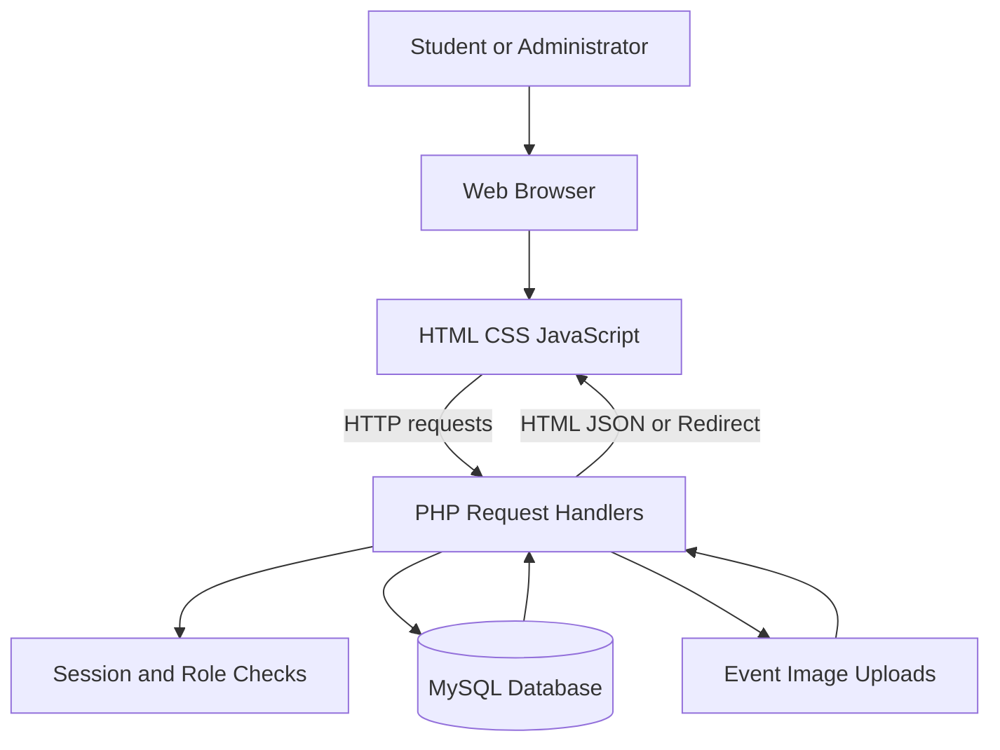
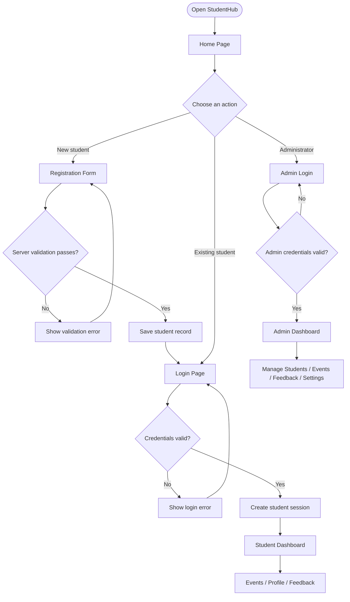
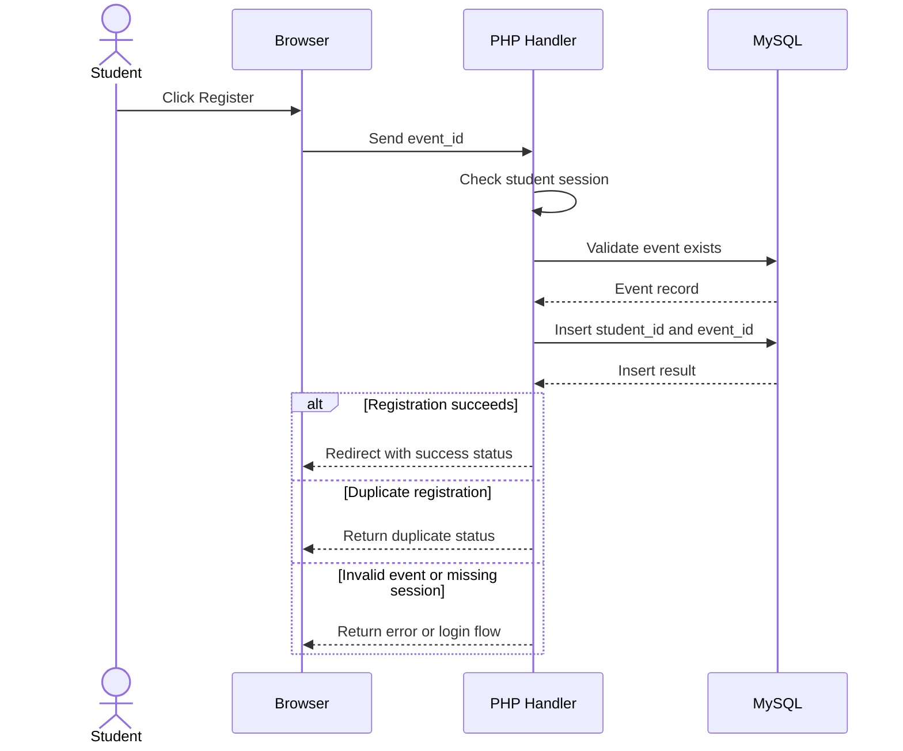
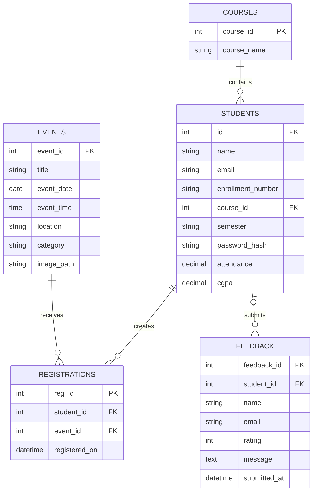

# StudentHub — Digital Campus Portal


StudentHub is a centralized digital campus portal developed to simplify student services and campus activities through a unified web application. Built using **HTML, CSS, JavaScript, PHP, and MySQL**, it brings together student authentication, personalized dashboards, campus event discovery and registration, feedback management, and administrative operations. The platform provides separate workflows for students and administrators, with database-driven functionality and a structured approach to managing campus information.

------------------------------------------------------------------------

## Contents

-   [Overview](#overview)
-   [Problem Statement](#problem-statement)
-   [Objectives](#objectives)
-   [Features](#features)
-   [User Roles](#user-roles)
-   [Pages](#pages)
-   [System Architecture](#system-architecture)
-   [Application Flow](#application-flow)
-   [Event Registration Flow](#event-registration-flow)
-   [Database Design](#database-design)
-   [Technology Stack](#technology-stack)
-   [Project Structure](#project-structure)
-   [Installation and Usage](#installation-and-usage)
-   [Configuration](#configuration)
-   [Security](#security)
-   [Deployment](#deployment)
-   [Testing Checklist](#testing-checklist)
-   [Future Enhancements](#future-enhancements)
-   [Contributing](#contributing)
-   [Author](#author)
-   [License](#license)

## Overview

StudentHub is designed as a single access point for student-facing
campus services and administrative operations. Students can create an
account, sign in, view their dashboard, explore campus events, register
for events, view profile-related information, and submit feedback.
Administrators can access a protected workspace to manage student
records, events, feedback, and supported system settings.

The application uses browser-based pages, PHP request handlers, and a
MySQL database. It can be developed locally with XAMPP and deployed to a
PHP-compatible hosting provider.

## Problem Statement

Campus information and student services can be spread across different
pages or manual processes. Students need a convenient way to find event
information, manage registrations, and reach relevant services.
Administrators also need a central place to maintain student and event
records.

StudentHub addresses this by bringing these workflows together in one
portal with separate student and administrator experiences.

## Objectives

1.  Provide one portal for student and campus-related services.
2.  Support student registration, login, and logout.
3.  Display personalized dashboard information.
4.  Make campus events discoverable and allow students to register.
5.  Provide About, Contact, FAQ, and Feedback pages.
6.  Provide administrator tools for student and event management.
7.  Store application information in a structured database.
8.  Maintain an organized codebase with Git and GitHub.

## Features

### Student

-   Student registration with server-side validation.
-   Password hashing during account creation.
-   Login and logout using PHP sessions.
-   Dashboard backed by PHP endpoints and MySQL data.
-   Profile and academic information where available.
-   Event listing with details and images.
-   Event registration with duplicate-registration protection.
-   Feedback submission.
-   About, Contact, and FAQ pages.

### Administrator

-   Separate admin login and protected admin endpoints.
-   Admin dashboard with summary information.
-   Student record management, including adding and deleting records.
-   Event creation with details and optional image upload.
-   Database-backed event listing for newly created events.
-   Feedback review.
-   Semester and system settings.
-   Record-management interface for students and events.

> **Implementation note:** The settings page stores maintenance-mode
> configuration. Verify site-wide enforcement separately before treating
> it as an active restriction.

## User Roles

  -----------------------------------------------------------------------
  Role                                Responsibilities
  ----------------------------------- -----------------------------------
  Student                             Register, sign in, view dashboard,
                                      browse and register for events,
                                      view profile information, and
                                      submit feedback.

  Administrator                       Access the admin workspace, manage
                                      student records and events, review
                                      feedback, and update supported
                                      settings.
  -----------------------------------------------------------------------

## Pages

  Page                Purpose
  ------------------- ---------------------------------------------------
  Home                Main entry point.
  About               Portal information.
  Register            Create a student account.
  Login               Student sign-in.
  Student Dashboard   Personalized student information.
  Events              Browse campus events and register.
  Profile             View profile-related information.
  Contact             Contact information.
  FAQ                 Frequently asked questions.
  Feedback            Submit feedback.
  Admin Login         Administrator authentication.
  Admin Dashboard     Administrative overview.
  Add Student         Create a student record.
  Create Event        Create an event and optionally upload an image.
  Delete Records      Manage student and event deletion.
  Admin Feedback      Review feedback submissions.
  Admin Settings      Configure supported semester and system settings.

## System Architecture



**Layer responsibilities**

-   **Browser:** Displays pages and handles user interactions.
-   **Frontend:** Provides page structure, styling, form interactions,
    and API requests.
-   **PHP:** Validates requests, manages sessions, executes database
    queries, and returns HTML, JSON, or redirects.
-   **MySQL:** Stores students, courses, events, registrations,
    feedback, and settings.
-   **Uploads:** Stores event images submitted through the
    event-management workflow.

## Application Flow



> If email OTP login is implemented later, update this flow so the
> authenticated student session is created only after OTP verification
> succeeds.

## Event Registration Flow



The registration table uses a unique constraint on the student/event
pair to help prevent duplicate registrations.

## Database Design

The local database is named `studenthub`. Main tables:

  -----------------------------------------------------------------------
  Table                               Purpose
  ----------------------------------- -----------------------------------
  `students`                          Student identity, login,
                                      enrollment, course, semester, and
                                      academic information.

  `courses`                           Course or department information.

  `events`                            Event title, date, time, location,
                                      category, description, and image
                                      path.

  `registrations`                     Relationship between students and
                                      events.

  `feedback`                          Feedback messages, ratings,
                                      submitter details, and timestamps.

  `system_settings`                   Semester dates and supported system
                                      configuration.
  -----------------------------------------------------------------------

### Simplified entity relationship diagram



This is a simplified logical view. Refer to `studenthub_schema.sql` and
the actual database for exact column types, indexes, and constraints.

## Technology Stack

  Technology     Usage
  -------------- --------------------------------------------------------------
  HTML5          Page structure and forms
  CSS3           Layout, responsive styling, and visual design
  JavaScript     Client-side interactions and API requests
  PHP            Server-side logic, sessions, validation, and database access
  MySQL          Persistent application data
  PDO            Parameterized PHP database queries
  XAMPP          Local Apache, PHP, and MySQL environment
  phpMyAdmin     Database administration
  Git            Version control
  GitHub         Repository hosting
  InfinityFree   PHP/MySQL deployment environment

## Project Structure

The following is a representative structure; individual filenames may
vary by version.

``` text
StudentHub/
├── css/
│   └── style.css
├── data/
│   └── .htaccess
├── docs/
│   ├── wireframes/
│   └── sitemap.png
├── image/
│   └── [images and logo]
├── js/
│   └── script.js
├── pages/
│   ├── index.html
│   ├── about.html
│   ├── login.html
│   ├── registar.html
│   ├── dashboard.html
│   ├── events.html
│   ├── profile.html
│   ├── feedback.html
│   └── [admin and supporting pages]
├── php/
│   ├── db_connect.php
│   ├── login.php
│   ├── logout.php
│   ├── dashboard.php
│   ├── events.php
│   ├── process_registration.php
│   ├── process_event_registration.php
│   └── [admin and supporting handlers]
├── uploads/
│   └── events/
├── studenthub_schema.sql
└── README.md
```

## Installation and Usage

### Requirements

-   XAMPP with Apache, PHP, and MySQL/MariaDB.
-   A modern web browser.
-   Visual Studio Code or another code editor.
-   Git, if cloning the repository.
-   Composer only if a library used by the project requires it.

### 1. Start services

Open XAMPP Control Panel and start **Apache** and **MySQL**.

### 2. Place the project in `htdocs`

For a typical Windows XAMPP installation, use:

``` text
C:\xampp\htdocs\StudentHub
```

Or clone the repository:

``` bash
git clone https://github.com/harshkunpara/StudentHub.git
```

Ensure the cloned folder is inside XAMPP's `htdocs` directory.

### 3. Create and import the database

Open:

``` text
http://localhost/phpmyadmin
```

Create a database named `studenthub`, select it, and import
`studenthub_schema.sql`. If the SQL file already creates/selects the
database, follow its instructions.

### 4. Configure the connection

Open `php/db_connect.php` and set the local host, database name,
username, and password to match your XAMPP configuration. A common local
setup uses `localhost`, username `root`, and an empty password, but your
configuration may differ.

Do not use production hosting credentials in the local configuration.

### 5. Open the website

If the home page is under `pages/`, open:

``` text
http://localhost/StudentHub/pages/index.html
```

If your version has a root-level `index.php` or `index.html`, use that
entry point instead.

### 6. Verify the database connection

Use the project's existing database test endpoint only in local
development. Remove or restrict diagnostic scripts before public
deployment.

## Configuration

### Separate local and production settings

Maintain separate configuration values for local development and
production hosting:

-   **Local:** XAMPP database credentials.
-   **Production:** Hosting provider's database hostname, database name,
    username, and password.

A local edit does not update the deployed website automatically. Upload
changed files to the matching path on the hosting server.

### File uploads

Event images are stored under `uploads/events/` in the current
implementation. Ensure the directory is writable by PHP on the hosting
environment and validate file types and sizes on the server.

## Security

-   Store passwords with PHP password-hashing functions and verify them
    using `password_verify()`.
-   Use PDO prepared statements for user-supplied SQL values.
-   Validate all important inputs on the server.
-   Regenerate session IDs after successful authentication.
-   Enforce student/admin authorization in protected PHP endpoints, not
    only by hiding frontend links.
-   Use HTTPS in production.
-   Validate upload types and file sizes; never trust a filename alone.
-   Keep database credentials, API keys, and SMTP passwords out of
    frontend code and public Git commits.
-   If email OTP is added, use short expiry, attempt limits, resend
    limits, and safe secret storage.
-   Avoid hard-coded administrator credentials in a public deployment.
-   Disable verbose debug output on a live site.

## Deployment

For PHP/MySQL hosting such as InfinityFree:

1.  Create or configure the hosting database.
2.  Import the project schema.
3.  Configure production database credentials in the production copy of
    `php/db_connect.php`.
4.  Upload project files to the correct web root while preserving
    folders such as `pages/`, `php/`, `css/`, `js/`, `image/`, and
    `uploads/`.
5.  Confirm the host supports the PHP features used by the project.
6.  Test registration, login, dashboard, events, event registration,
    feedback, and admin access.
7.  Verify uploaded images and frontend assets.
8.  Remove debug scripts and ensure secrets are not publicly accessible.

## Testing Checklist

### Student workflow

-   [ ] Home page and navigation links work.
-   [ ] Registration rejects invalid input.
-   [ ] Duplicate email or enrollment is handled.
-   [ ] Passwords are stored as hashes.
-   [ ] Correct login credentials create a student session.
-   [ ] Incorrect credentials are rejected.
-   [ ] Logout clears the session.
-   [ ] Dashboard displays the logged-in student's information.
-   [ ] Database-backed events appear.
-   [ ] Students can register for valid events.
-   [ ] Duplicate event registration is prevented.
-   [ ] Feedback can be submitted and viewed by an administrator.

### Administrator workflow

-   [ ] Admin login accepts valid credentials and rejects invalid ones.
-   [ ] Protected endpoints reject unauthenticated requests.
-   [ ] Student records can be added and viewed.
-   [ ] Event creation validates fields and image uploads.
-   [ ] Newly created events appear on the events page.
-   [ ] Student/event deletion handles related registrations safely.
-   [ ] Feedback is visible in the admin view.
-   [ ] Supported settings can be saved and loaded.

### Deployment checks

-   [ ] Production database connection works.
-   [ ] HTTPS is active.
-   [ ] CSS, JavaScript, and images load correctly.
-   [ ] Debug information and secrets are not exposed.
-   [ ] Core workflows work on mobile and desktop.
-   [ ] Deployed files match the tested version.

## Future Enhancements

Potential improvements---not claims of current implementation---include:

-   Email OTP login with expiry, attempt limits, and resend limits.
-   Password reset by verified email.
-   Search, filters, and pagination for larger datasets.
-   Stronger administrator account management.
-   Audit logs for important administrative actions.
-   Site-wide enforcement and user-facing behavior for maintenance mode.
-   Automated tests for validation, authentication, and event
    registration.
-   Accessibility improvements and broader browser testing.
-   Environment-based configuration and improved logging/backups.

## Contributing

1.  Fork the repository.
2.  Create a feature branch.
3.  Make a focused change.
4.  Test the relevant workflow locally.
5.  Commit with a clear message.
6.  Open a pull request describing the change and tests.

``` bash
git checkout -b feature/describe-your-change
git add .
git commit -m "feat: describe your change"
git push origin feature/describe-your-change
```

Never commit passwords, API keys, `.env` files, database dumps
containing personal data, or unnecessary generated files.

## Author

**Harsh Kunpara**

Student developer interested in full-stack web development and practical
campus-focused software.

-   GitHub: [harshkunpara](https://github.com/harshkunpara)
-   Repository: [StudentHub](https://github.com/harshkunpara/StudentHub)

## License

This project is licensed under the **MIT License**.

You are free to use, copy, modify, merge, publish, distribute, sublicense, and sell copies of the software, subject to the terms and conditions of the license.

See the [LICENSE](LICENSE) file for the complete license text.
